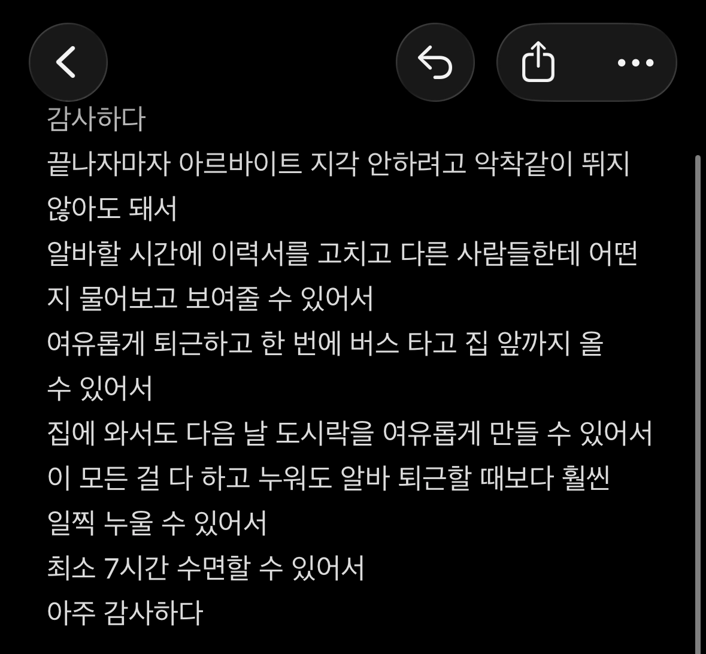
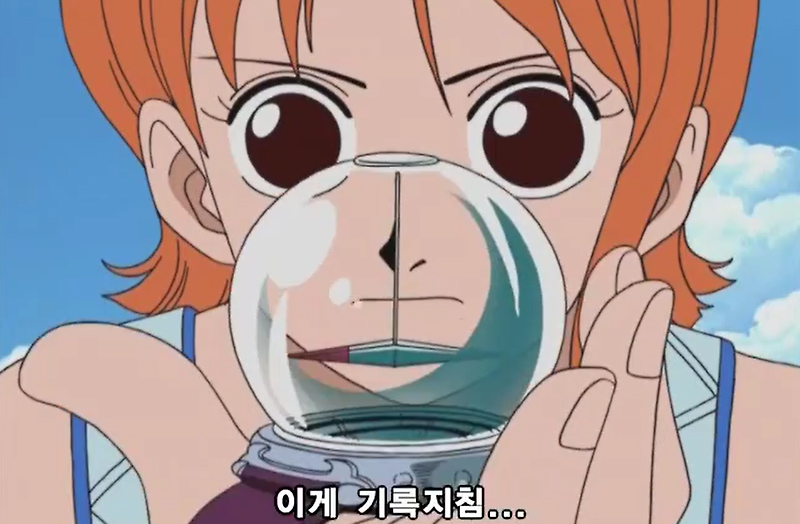
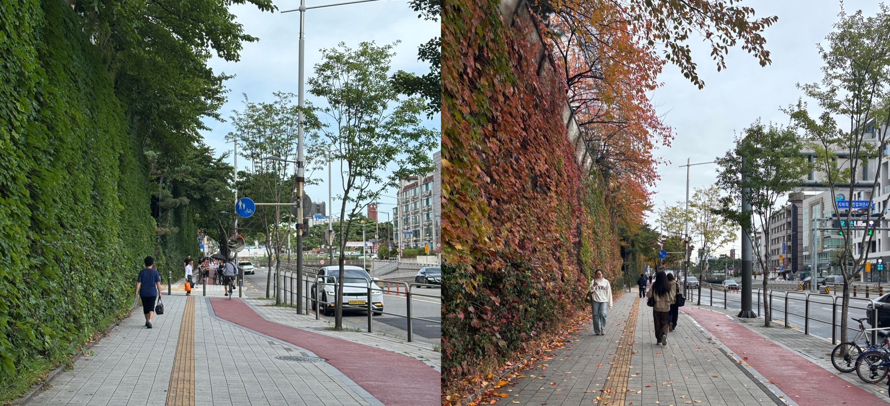

<iframe width="100%" height="360" src="https://www.youtube.com/embed/4meVNsnFCQQ" title="YouTube video player" frameborder="0" allow="accelerometer; autoplay; clipboard-write; encrypted-media; gyroscope; picture-in-picture" allowfullscreen></iframe>

 

졸업한 이후 지난 2년은 나에게 길었던 **환절기(換節期)**였다. 환절기는 한 계절에서 다른 계절로 넘어가는 시기를 말한다. 일교차가 크고 공기가 건조해 컨디션에 유의해야 하고, 감기나 몸살이 찾아오기도 한다. 나에겐 지난 2년이 그랬던 것 같다.

캠프가 끝나가면서 해가 짧아지고 밤낮으로 겨울의 서늘한 공기가 느껴지는 지금, 지독했던 환절기가 끝나가고 있음을 느끼고 있다.

**캠프 전 나는 용기가 없는 사람이었다.**

졸업 후 국비 지원 부트캠프 하나를 수료하고, 더 이상 어딘가에 소속되지 않은 채로 혼자 아르바이트를 하며 취업 준비를 했다. 나는 아직 모르는 게 너무 많지만 더 이상 다른 교육은 들을 수 없었고, 사이드 프로젝트를 하고 있지만 이렇다 할 경험은 없는 채였다.

나는 나에 대한 확신이 없었다. 프로젝트를 하면서도 내가 하는 모든 일들이 그냥 다 거짓말 같았다. 현업은 좀 다르지 않을까, 그들이 보기엔 내가 한 모든 일들이 다 애들 장난 같지 않을까. 내가 가진 경험이 손에 잡히지 않는, 불면 날아가 버릴 것 같은 한 줌의 재 같았다.

어딘가에 지원할 생각은 해보지도 않았다. 난 아직 준비된 상태가 아니라고 생각했다. 기술 지식을 완벽하게 습득하고, 이력서에 넣을 대단한 경험이 생기면 지원할 수 있는 완벽한 상태가 될 거라고 생각하고 있었다. 그렇게 이도 저도 아닌 상태에 머물러 있었다. "난 언젠가 준비된 상태가 될 거니까"라고 스스로를 위로했던 것 같다.

그렇게 어영부영 1년 반이 흘렀고, 어느 순간 이제는 더 이상 미룰 수 없겠다는 생각이 들었다. 다른 것들은 신경 쓰지 않고 하루 온종일 집중해서 취업 준비를 하고 싶다는 생각하던 차에 커리어캠프를 알게 되었다.

## 꽤나 간절했던 4개월 전의 나

커리어 캠프를 처음 알게 되었을 때, 신청할지 일주일 정도 진지하게 고민했었다. 교육을 시작하고 수료한다고 다가 아니라 내가 그 안에서 얼마나 많은 것들을 해냈는지가 중요하다는 걸 지난 부트캠프에서 뼈저리게 느꼈던 터라, 그냥 교육 하나 더 듣는 것 정도로 끝날 바엔 안 하는 게 낫다고 생각했기 때문이다.

하지만 더 이상 주 4일 아르바이트를 하면서 취업 준비를 병행하고 싶지 않았다. 생활비나 멘토링 비용 신경 쓰지 않고 온전히 취업 준비에만 집중할 수 있는 환경이 절실했다. '내가 또 부트캠프를 들을 수 있다면 이번엔 정말 잘할 수 있을 텐데' 하는 아쉬움도 마음속에 남아 있었던 것 같다. 그래서 이번엔 정말 달라야 한다는 간절한 마음으로 커리어 캠프에 참여하게 되었다.

나의 우려가 무색하게, 커리어 캠프는 하루 10시간 온전히 내가 가진 경험과 앞으로의 커리어 방향성에 대해 생각할 수 있는 최적의 환경이었다. 캠프 합류가 갑자기 결정되면서 초반 2주 정도는 캠프 출근과 아르바이트 출근을 병행했었는데, 몸은 정말 피곤하지만 마음은 편했던 것 같다. 아르바이트를 퇴사하고 나서는 이렇게 온전히 나에게 집중할 수 있는 시간이 주어졌음에 감사해서 감사 일기도 썼다. 당시에는 그만큼이나 간절했었다.

## 캠프를 시작하고

### 나에 대해 알아가기

캠프를 시작하고 가장 먼저 느꼈던 건, 나는 나 자신에 대해 잘 모른다는 것이었다.

이력서를 잘 쓰려면 스스로에 대해 제대로 알아야 한다. 이력서를 쓰기 위해 내가 가진 역량과 경험을 정리하다 보면, 결국 종점에는 '나는 어떤 사람인가?'라는 질문을 하게 된다. 내가 어떤 걸 좋아하는지, 어떨 때 행복한지, 어떤 일에 자신을 갖는지를 알아야 좋은 이력서를 쓸 수 있다는 걸 느꼈다.

그리고 그 질문의 답을 찾아가는 과정이 취업 준비뿐만 아니라 나의 앞으로의 커리어에서도 가장 중요하다는 걸 알게 되었다. 그동안 만난 많은 현직자 멘토님들은 다들 자신이 어떨 때 행복한지 명확히 알고 있었고, 이걸 본인의 커리어에도 이어가고 있었다. 나를 잘 알아야 앞으로의 커리어 패스를 설계하고 목표를 세울 수 있는 것이다.

솔직히 말하면 나는 아직까지도 내가 어떤 사람인지, 뭘 좋아하는지 잘 모르겠다. 강점 비슷한 게 머릿속을 스쳐도 그 정도는 누구나 하지 않나, 남들도 다 하는 건데 그게 내 강점이 될 수 있나 하는 생각을 완전히 지울 수는 없을 것 같다.

그래도 4개월 간 내가 돌이켜 본 나에 대해 정리해 보면, 불안한 상태를 견디지 못하고 정리하는, 체계와 구조를 만드는 걸 좋아하는 사람. 그리고 그 과정을 계속 기록하고 남기고 싶어 하는 사람 정도로 설명할 수 있을 것 같다. 지금 이렇게 회고를 남기는 것도 그렇고, 캠프 기간 매일 회고를 적었던 것도. 트러블 슈팅 과정을 블로그에 열심히 쓰고 학습 기록을 노션에 매일 적고 있는 것도. 다 내가 그런 사람이었기 때문에 가능한 일이라는 생각이 이제는 든다.

### 세상에 완벽한 건 없다

캠프가 진행되면서 가장 크게 느꼈던 건, 이 세상에 완벽하게 준비된 상태란 건 없다는 점이었다.

그동안의 나는 부족한 나를 드러내기를 무서워했었다. 조금만 더 고치고, 조금만 더 수정하고, 조금만 더 공부하고라는 핑계를 대며 지원을 미뤄 왔다.

하지만 이번 캠프 기간 만큼은 그러지 않고 싶었다. 정말 간절했던 만큼 이번엔 달라지고 싶었다. 그래서 이력서가 완벽하지 않아도, 아쉬운 부분이 있어도 매주 10개 이상의 공고에 꾸준히 지원했다. 지원하고 이력서 수정하고, 또 지원하고 수정하고를 반복하다 보니 한 달 동안 100개 정도의 공고에 이력서를 넣게 되었다.

그 과정에서 90개가 넘는 서류 탈락의 고배를 마셨고, 이 세상 어느 회사도 나를 받아주지 않을 것 같은 두려움에 우울하기도 하고 자존감도 많이 낮아지기도 했다. 하지만 그럴 때마다 한 걸음 물러나서 생각해 보려고 노력했다. 아직 이게 끝이 아니고, 지금은 이 이력서의 합격률을 점검하는 단계다. 겨우 몇 개의 불합격 가지고 좌절하지 말자. 데이터를 모으다 보면 개선할 부분이 분명 보일 거다. 라고.

서류 합격한 회사들을 보며 내 이력서가 어떤 회사에 통하는지, 탈락한 회사들은 어떤 게 문제였는지 감이 잡혔다. 내 서류의 문제점을 합격 데이터를 토대로 진단할 수 있게 된 것이다. 이걸 깨닫고 나니 그동안 지원을 겁먹었던, 불합격에 좌절하고 우울했던 내가 우습게 느껴졌다.

이렇게 쌓은 데이터가 있으니, 앞으론 어떤 것들을 더 개선해야 할지가 훨씬 명확해졌다. 취업 시장이라는 위대한 항로에 들어서면서 기록 지침을 얻은 밀짚모자 해적단이 된 기분이랄까?

### 변하지 않는 것

'AI 네이티브' 커리어 캠프였던 만큼, 채용 시장에서 뜨거운 감자인 AI를 잘 활용하는 방법에 대해서도 배울 수 있었다. 캠프 전과 후의 AI 활용 역량을 비교해 보라고 한다면 말도 안 되게 차이가 많이 난다. 개발에서 어떤 식으로 AI를 활용하는지, AI가 만든 결과물을 어떻게 검증할 것인지, 또 AI가 점거한 취업 시장에서 신입으로서 어떻게 살아남을 것인지 등등. 혼자 취업 준비를 했다면 이렇게까지 AI에 대해 깊게 고민해 보진 못했을 것 같다.

하지만 그간의 고민을 돌이켜 보면, 오히려 역설적으로 **AI가 판치는 세상에서도 변하지 않는 건 무엇인지**에 대해 더 많이 생각했던 것 같다. 개발자란 원래 시스템에 대한 깊은 이해를 토대로 시시각각 변하는 기술에 빠르게 적응해야 하는 직업이었고, 지금은 기술이 AI가 되었을 뿐 사실 본질은 크게 달라지지 않았다.

결과물을 만드는 건 AI가 대신할 수 있어도, 그걸 이해하고 판단하고 책임지는 건 결국 사람이다. AI 툴이나 도구는 계속 변하지만, 기술을 이해하고 판단한 기록은 변하지 않고 끝까지 내 것으로 남는다. AI의 홍수 속에서 결코 변하지 않는 내 안의 알맹이가 뭘까, 4개월간 고민한 결과 지금은 내 알맹이의 모양이 얼핏 보이는 듯하다.

## 캠프를 마무리하며

커리어에는 끝이 없다. 사람은 죽을 때까지 자신의 커리어를 고민한다.

4개월 간의 커리어 캠프는 앞으로 나를 평생 따라다닐 이 고민을 어떻게 헤쳐나갈지 알려주는 기록 지침이 되어 주었다. 이제 방향을 잡았으니, 앞으로 어떤 방향으로 어떻게 나아갈지는 나의 몫이다.

이제 이 출퇴근길도 끝이라니 시원섭섭합니다. 길었던 저의 환절기를 끝낼 수 있게 도와준 AI 네이티브 커리어 캠프, 4개월간 함께한 동기분들, 그리고 교육을 운영해 주신 모든 운영진 분들께 이 글을 빌려 감사 인사를 전합니다. 그리고 4개월 동안 치열하게 달려온 나 자신에게도 오늘만큼은 수고했다고 말해주고 싶습니다.
